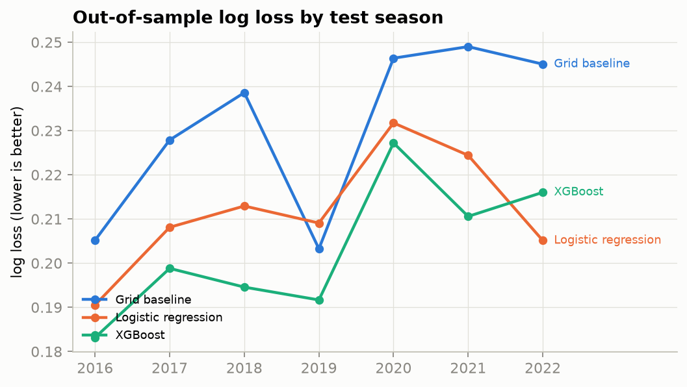
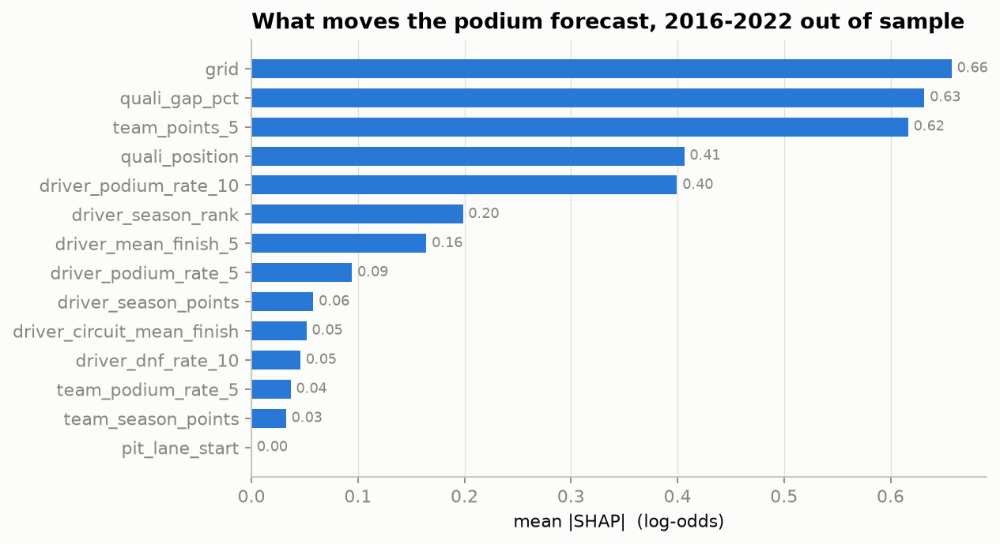
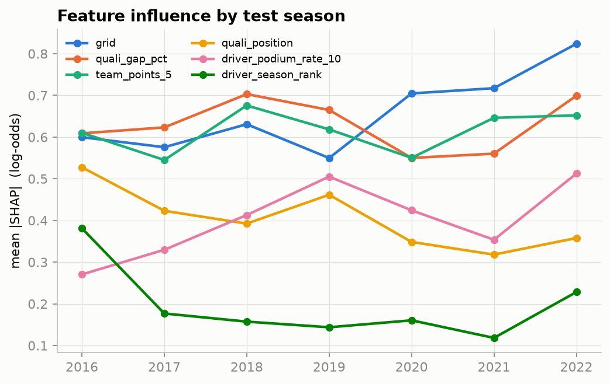
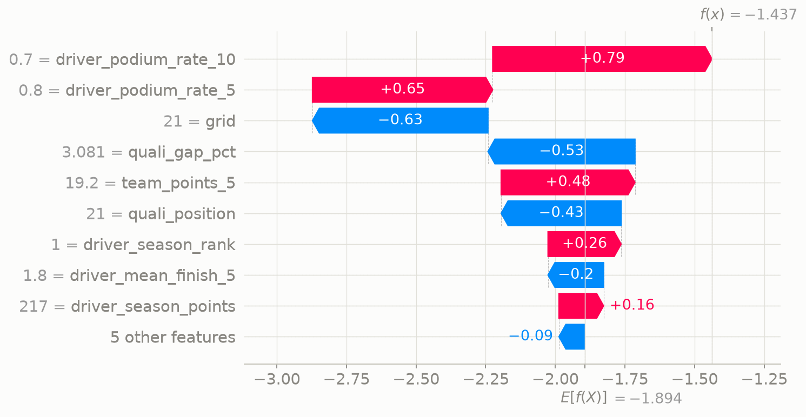
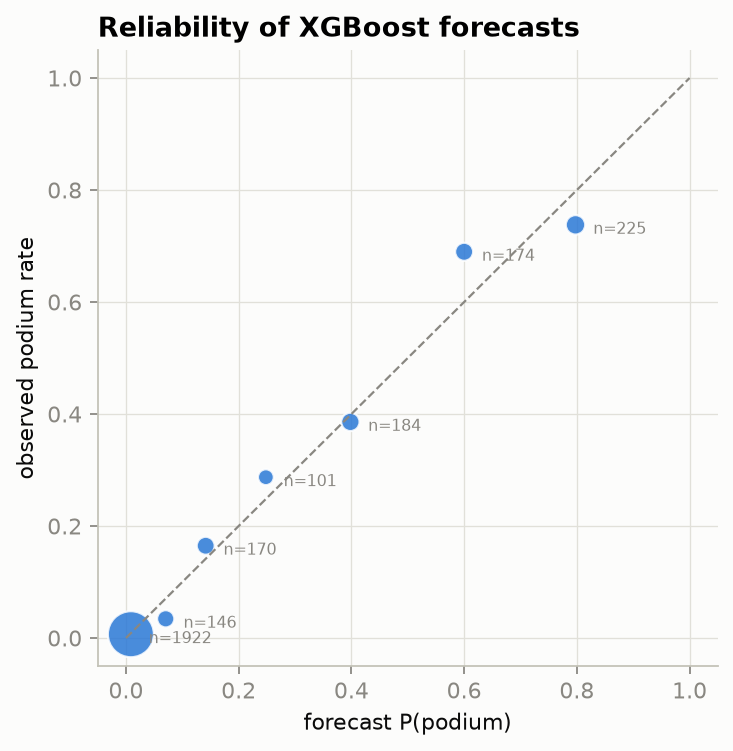

# F1 podium forecast

Before a Formula 1 race, what is each driver's chance of finishing in the top
three? And can a model estimate that better than just looking at the starting
grid?

I built this to practise the things that matter in quant finance work:
features that only use information available at the time, a backtest that
walks forward through time, a simple benchmark to beat, proper scoring of
probabilities, a holdout I only looked at once, and an explanation of what the
model is doing. F1 is just the data.

## Summary

- Data: 6,436 driver-race rows, 305 races, 2010 to 2024. 14.2% of rows are podiums.
- 14 features, all known before the race starts.
- Model: XGBoost with fixed settings (depth 3), number of trees chosen by early stopping.
- Benchmark: the historical podium rate for each grid slot.
- Validation: train on all seasons before a test season, test on that season, move forward a year. Test seasons 2016 to 2022. 2023 and 2024 kept back as a holdout.

Results:

- Over the seven test seasons, log loss drops from 0.231 (grid) to 0.203 and
  Brier skill over the grid is +6.2%. The model beats the grid in every
  season, though 2019 is close enough to be noise.
- The probabilities are calibrated without any extra step: when it says 30%,
  it happens about 30% of the time.
- On the 2023 to 2024 holdout it wins in 2023 and loses in 2024. Pooled, log
  loss improves a little but Brier skill is flat.
- Three things drive the forecast about equally: grid slot, how far off the
  pole lap the driver qualified, and the team's recent points.
- Tuning the hyperparameters made out-of-sample results worse, so I kept the
  defaults.

## Results

### Walk-forward, test seasons 2016 to 2022

Each season is predicted by a model trained only on the seasons before it.
Averages over the seven seasons (lower is better for log loss and Brier,
higher for the rest):

| Model | Log loss | Brier | ROC-AUC | PR-AUC | Calibration error | Top-3 hit rate | Brier skill vs grid |
|---|---|---|---|---|---|---|---|
| Grid baseline | 0.231 | 0.068 | 0.922 | 0.670 | 0.025 | 69.9% | 0 |
| Logistic regression | 0.212 | 0.065 | 0.938 | 0.713 | 0.025 | 68.8% | +4.2% |
| **XGBoost** | **0.203** | **0.064** | **0.944** | **0.729** | 0.031 | 69.9% | **+6.2%** |
| XGBoost, tuned | 0.205 | 0.065 | 0.943 | 0.717 | 0.033 | 71.1% | +4.9% |



Brier skill over the grid, season by season:

| Season | Logistic | XGBoost | XGBoost tuned |
|---|---|---|---|
| 2016 | +4.6% | +6.0% | +3.3% |
| 2017 | +2.3% | +5.3% | +5.8% |
| 2018 | +4.3% | +9.6% | +9.5% |
| 2019 | -4.6% | +1.2% | -4.3% |
| 2020 | +7.6% | +7.4% | +6.3% |
| 2021 | +5.2% | +9.6% | +9.4% |
| 2022 | +10.2% | +4.4% | +4.4% |

2019 was hard for every model because Mercedes started at the front and
stayed there, so the grid was already almost right. The margin is small
enough that it depends on the machine: on x86 Linux, with the same code and
library versions, 2019 comes out at -1.3% and the average at +5.7%, because
XGBoost's random row sampling plays out differently. The numbers above are
from an Apple-silicon Mac with the versions pinned in `pyproject.toml`.

### Holdout, 2023 to 2024

I didn't use these two seasons for any decision. Each model was trained once
on 2010 to 2022 and scored once.

| Model | Season | Log loss | Brier | ROC-AUC | Brier skill vs grid |
|---|---|---|---|---|---|
| Grid baseline | 2023 | 0.257 | 0.074 | 0.896 | 0 |
| | 2024 | 0.230 | 0.069 | 0.920 | 0 |
| | both | 0.243 | 0.071 | 0.909 | 0 |
| Logistic regression | 2023 | 0.224 | 0.067 | 0.927 | +10.1% |
| | 2024 | 0.233 | 0.072 | 0.927 | -4.5% |
| | both | 0.228 | 0.069 | 0.928 | +2.8% |
| **XGBoost** | 2023 | 0.226 | 0.069 | 0.928 | +7.5% |
| | 2024 | 0.237 | 0.073 | 0.926 | -7.2% |
| | both | 0.231 | 0.071 | 0.928 | +0.1% |
| XGBoost, tuned | 2023 | 0.222 | 0.068 | 0.929 | +8.4% |
| | 2024 | 0.223 | 0.069 | 0.933 | -1.2% |
| | both | 0.223 | 0.069 | 0.932 | +3.6% |

Every model beat the grid in 2023 and none did on Brier in 2024. Pooled,
XGBoost still has lower log loss (0.231 vs 0.243) and ranks drivers better
(ROC-AUC 0.928 vs 0.909), but its Brier skill is flat.

The tuned model did better than the defaults on the holdout. I still use the
defaults: the tuned model was worse on the seven development seasons, and
picking whichever version wins on the holdout would turn the holdout into
another training set.

### Is the edge real?

To get error bars I computed the log-loss gain over the grid for each race and
bootstrapped over races (95% interval). I resample races rather than drivers
because drivers in the same race aren't independent: exactly three of them
get a podium.

| Period | Gain per race | 95% CI | Races where the model was better |
|---|---|---|---|
| Walk-forward 2016 to 2022 | +0.028 | +0.019 to +0.038 | 72% of 144 |
| Holdout 2023 | +0.031 | +0.002 to +0.060 | 64% of 22 |
| Holdout 2024 | -0.007 | -0.022 to +0.011 | 25% of 24 |
| Holdout pooled | +0.011 | -0.006 to +0.029 | 43% of 46 |

On the walk-forward seasons the interval is well above zero. On the holdout,
2023 just clears zero, 2024 doesn't, and with only 46 races the pooled gain
can't be told apart from zero. So across nine out-of-sample seasons: seven
clear wins, 2019 roughly a draw, 2024 a loss. My reading is that the edge is
real but small, and one season where the grid is unusually accurate (2024's
grid log loss was among the lowest of any year, like 2019) is enough to wipe
it out.

The race-level numbers also show how the model wins. In the holdout it was
better in fewer than half the races but still had a positive average gain.
The wins are big and rare (a fast car starting far back, where the model
gives a real podium chance and the grid gives almost none). The losses are
small and frequent (the cost of keeping that chance open every race).

## What drives the forecasts (SHAP)

SHAP splits each forecast into a contribution from each feature, in log-odds.
I compute it on each test season using the model trained on the seasons
before, so the explanations are out of sample like the forecasts.



Grid slot (0.66), gap to the pole lap (0.63) and team points over the last
five races (0.62) matter about equally. A change of about 0.7 in log-odds
roughly doubles the odds. Next are qualifying position (0.41) and the
driver's podium rate over the last ten races (0.40). The rest is small.

Two things stand out:

- The qualifying gap adds information the grid order doesn't have. Pole by
  half a second and pole by a hundredth are the same grid slot but very
  different races.
- The car matters as much as where it starts. A strong car that qualified
  badly (penalty, wet session, mistake) still has a real podium chance, and
  most of the model's edge over the grid comes from those cases.



Feature importance moves around between seasons. Grid position became more
important from 2020 while the qualifying gap became less important, which
fits with qualifying margins getting closer. Championship rank mattered most
in 2016 and little after.



Example: Lewis Hamilton at the 2016 Belgian Grand Prix, starting 21st after
engine penalties. The starting point is the average podium chance, 13%
(log-odds -1.89). His recent podium rate (+0.79 over ten races, +0.65 over
five), team points (+0.48) and championship position (+0.26) push it up. Grid
slot (-0.63), qualifying gap (-0.53) and qualifying position (-0.43) push it
down. The forecast ends at 19%, where the grid baseline says about 1%. He
finished third.

## Metrics

Plain accuracy doesn't work here: predicting "no podium" for everyone is 86%
accurate. These are the metrics for probability forecasts:

| Metric | What it measures |
|---|---|
| Log loss | How good the probabilities are, with heavy penalties for confident wrong forecasts. My main metric. |
| Brier score | Mean squared error between the probability and the 0/1 outcome. |
| Brier skill | 1 - (model Brier / grid Brier). Above 0 means the model adds something over the grid, like excess return over a benchmark. |
| ROC-AUC | Take one podium finisher and one non-podium driver at random: how often the model ranks them the right way round. |
| PR-AUC | Ranking quality focused on the rare podium rows. |
| Calibration error (ECE) | Average gap between predicted and actual podium rate, across ten probability bins. |
| Top-3 hit rate | Of the model's top three picks per race, the share that made the podium. |

The top-3 hit rate barely changes between models because they all pick the
front row. The differences are in how they price the midfield, which log
loss and Brier pick up.

## Data

Kaggle dataset
[rohanrao/formula-1-world-championship-1950-2020](https://www.kaggle.com/datasets/rohanrao/formula-1-world-championship-1950-2020)
(it actually runs to the end of 2024). Missing values are written as `\N`.
The CSVs aren't committed; `data/` is git-ignored.

I use four tables: `results` (finishing order, the target and past form),
`races` (date, season, round, circuit), `qualifying` (position and lap
times), and `drivers` (names, only for the SHAP example).

Not used:

- `driver_standings` and `constructor_standings`: these are recorded after
  each race, so joining them on the same race leaks the result. I rebuild
  season points from `results` instead.
- `lap_times` and `pit_stops`: could give a pace feature later.
- `sprint_results`: sprints are left out, so season points are Grand Prix
  points only and 2021 to 2024 ranks differ slightly from the official
  standings.

I start in 2010 because that's when the current 25-point system started.
Earlier years had different points, grid sizes and reliability.

## How it works

### Base table (`dataset.py`)

One row per driver per race. The columns are split into three groups so it's
clear what can be used as a feature:

- keys: race, driver, team, season, round, date, circuit
- pre-race facts (fine to use): grid slot, pit-lane start flag, qualifying
  position, best qualifying lap
- outcomes (only as the label or in lagged features): finishing order,
  classified or not, points, status, and `podium` (finished 1st to 3rd)

Two cleaning steps. The dataset codes a pit-lane start as grid 0, which would
look better than pole, so I move those cars to one slot behind the last car
and set a flag. And I parse the Q1/Q2/Q3 times and keep the fastest, for the
gap-to-pole feature.

### Features (`features.py`)

For race *t*, a feature can only use races before *t* plus the pre-race facts
for *t*. Every rolling window is shifted back one race before it's computed.

| Group | Feature | Meaning | Finance analogue |
|---|---|---|---|
| Start | `grid` | Starting slot | Current price |
| | `pit_lane_start` | Started from the pit lane (1/0) | Event flag |
| | `quali_position` | Qualifying position | |
| | `quali_gap_pct` | % slower than the pole lap (0 for pole) | Spread to best |
| Driver form | `driver_podium_rate_5`, `_10` | Share of the last 5 / 10 races on the podium | Momentum |
| | `driver_mean_finish_5` | Average finish over the last 5 races | Trend |
| | `driver_dnf_rate_10` | Share of the last 10 races not finished | Default risk |
| Team form | `team_podium_rate_5` | Podium rate of the team's cars over its last 5 races | Sector momentum |
| | `team_points_5` | Points per car per race over the last 5 races | |
| Championship | `driver_season_points` | Points earlier this season | Relative strength |
| | `driver_season_rank` | Rank of those points in this race | |
| | `team_season_points` | Team points earlier this season | |
| Track | `driver_circuit_mean_finish` | Average finish at this circuit before (since 2010) | Seasonality |

I kept the list short so every feature is easy to explain. Missing values
(first race, first visit to a circuit) are left as missing: XGBoost handles
them itself and the logistic model fills in the median from its training
data. Because history starts in 2010, the first few 2010 races have empty
form windows. That only affects early training rows; every test season has
full history.

### Avoiding look-ahead

| Risk | What I do |
|---|---|
| Standings tables include the race they're attached to | Don't use them; sum points from results and subtract this race |
| Outcome columns describe the race being predicted | Kept in `OUTCOMES`, never in the feature list |
| A rolling mean that includes this race | `shift(1)` before every rolling window |
| Whole-season averages | Only running totals up to the previous race |
| Random K-fold puts future races in training | Split by season only |
| Preprocessing fitted on all data | Imputer, scaler and model fitted inside each training window |

`tests/test_features.py` checks this directly. It builds features on a
synthetic three-season table, scrambles the results of one race in the
middle, rebuilds, and checks that nothing for that race or earlier changed.
It also checks that a later race did change, so the test can't pass by
accident. It runs in CI without the real data.

### Validation (`splits.py`)

```
train 2010-2015  ->  test 2016
train 2010-2016  ->  test 2017
   ...
train 2010-2021  ->  test 2022
train 2010-2022  ->  holdout 2023-2024, scored once
```

Inside each training window, the last season is held out again to choose
the number of trees (early stopping), and the hyperparameters when tuning is
on. The model is then refitted on the whole window. The test season never
affects any choice.

There's no gap between train and test because every label is known on race
day and every feature is lagged. Shuffled K-fold would use 2020 races to
predict 2016, so form features would effectively be learned from the
future.

### Models (`baseline.py`, `train.py`)

All models have the same `fit(df)` / `predict_proba(df)` interface so the
backtest treats them the same.

**Grid baseline.** Podium rate for each grid slot in the training window,
smoothed slightly toward the overall rate so rare slots aren't noisy. Slots
after 20th share one rate.

**Logistic regression.** Median imputation, scaling, then L2 logistic
regression on the 14 features. It shows how much of the gain comes from the
features and how much from XGBoost: most of it is the features (+4.2% of
the +6.2%).

**XGBoost.** A decision tree asks a few yes/no questions ("top three on the
grid? if not, has the team scored more than 10 points a race lately?") and
gives a podium probability at the end of each path. Boosting builds trees one
after another, each one fixing what the previous ones got wrong, and adds
them up. XGBoost is a fast implementation of that, and it deals with missing
values itself.

With only a few thousand rows I kept the settings cautious:

| Setting | Value | Why |
|---|---|---|
| Max depth | 3 | Shallow trees, less overfitting |
| Learning rate | 0.05 | Many small steps |
| Min child weight | 5 | No leaf built on a handful of rows |
| Row / column subsampling | 0.8 / 0.8 | Each tree sees a different sample |
| L2 regularisation | 1 | Default |
| Number of trees | Early stopping on the last training season, patience 50 | Usually 90 to 210 |

I tried a 20-draw random search over these settings, scored on the inner
validation season. It improved the inner loss by less than 0.005, the chosen
settings jumped around between seasons, and out of sample it was worse
(+4.9% vs +6.2% Brier skill). One season of about 400 rows is too small to
tune on. The search code is still there so this can be reproduced.

### Calibration



Pooled over 2016 to 2022. Dot size is the number of forecasts; a perfectly
calibrated model sits on the diagonal.

| Forecast bin | Drivers | Predicted | Observed |
|---|---|---|---|
| 0 to 5% | 1,922 | 0.9% | 0.7% |
| 5 to 10% | 146 | 7.1% | 3.4% |
| 10 to 20% | 170 | 14.1% | 16.5% |
| 20 to 30% | 101 | 24.8% | 28.7% |
| 30 to 50% | 184 | 39.8% | 38.6% |
| 50 to 70% | 174 | 60.0% | 69.0% |
| 70 to 100% | 225 | 79.8% | 73.8% |

Overall it predicts a 14.8% podium rate and 14.8% is observed.

I tried two calibrators, each fitted on the inner validation season:

| Variant | Log loss | Brier | Calibration error |
|---|---|---|---|
| XGBoost as is | 0.203 | 0.064 | 0.031 |
| + Platt scaling | 0.204 | 0.064 | 0.030 |
| + isotonic regression | 0.233 | 0.067 | 0.033 |

Platt scaling made no real difference and isotonic overfitted, so I don't use
either. The gap to the grid's calibration error (0.031 vs 0.025) is within
what you'd expect by chance with ten bins of about 400 rows.

Each race has exactly three podium places, so one race's probabilities should
add up to 3. The model scores each driver separately and is never told this,
but the sum averages 3.01. Rescaling each race to exactly 3 moves log loss
from 0.2024 to 0.2013 and Brier from 0.0638 to 0.0633, so I report the raw
probabilities. A conditional-logit or Plackett-Luce model would build the
constraint in.

## Limitations

- The edge is small. The grid comes from qualifying the day before, on the
  same track in the same car, which is about the best predictor of race pace
  there is.
- The holdout is mixed: good in 2023, bad in 2024. I report it as it came out
  rather than changing the model and re-scoring.
- The dataset has no betting odds, so I make no claims about making money.
  The results are only about forecast accuracy against the grid.
- Next features I'd try: pace from `lap_times` and `pit_stops`, weather, and
  regulation-era flags. Each would need to pass the leakage test.

## Running it

Python 3.12 or newer. Library versions are pinned so the numbers reproduce.

```bash
python -m venv .venv && source .venv/bin/activate
pip install -e ".[dev]"
pytest                    # 21 tests, no data needed
```

Download the data (no Kaggle account needed):

```bash
pip install kagglehub
python -c "
import kagglehub, shutil, pathlib
src = pathlib.Path(kagglehub.dataset_download('rohanrao/formula-1-world-championship-1950-2020'))
dst = pathlib.Path('data/raw'); dst.mkdir(parents=True, exist_ok=True)
for f in src.rglob('*.csv'): shutil.copy(f, dst / f.name)
"
```

Then:

```bash
python -m f1model.evaluate --data-dir data/raw --holdout   # backtest, holdout, bootstrap (~40 s)
python -m f1model.explain --data-dir data/raw              # SHAP and figures (~15 s)
```

All numbers and figures here come from those two commands. Tables go to
`reports/` as CSV and figures to `reports/figures/`.

## Files

```
src/f1model/
  load.py        read the CSVs
  dataset.py     one row per driver per race
  features.py    the 14 features
  baseline.py    grid baseline
  splits.py      walk-forward folds and holdout seasons
  train.py       logistic regression and XGBoost
  evaluate.py    metrics, backtest, holdout, bootstrap
  explain.py     SHAP and figures
tests/           21 tests on small synthetic data, run in CI
```

## Licence

MIT
