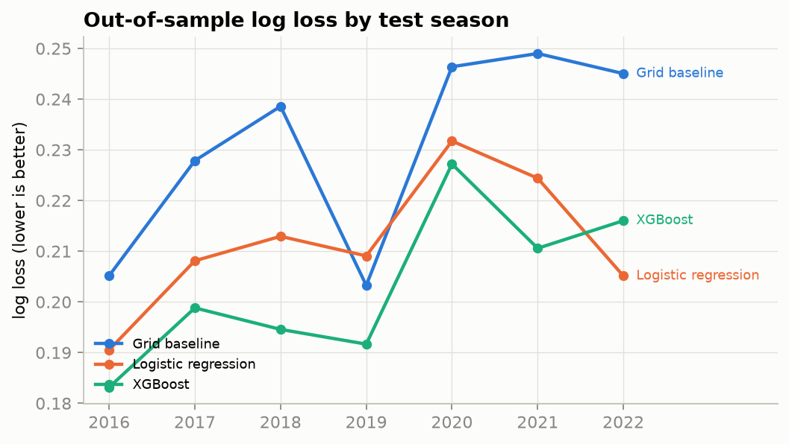
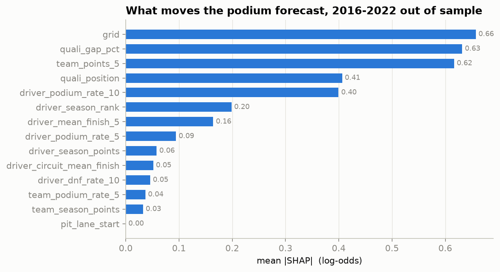
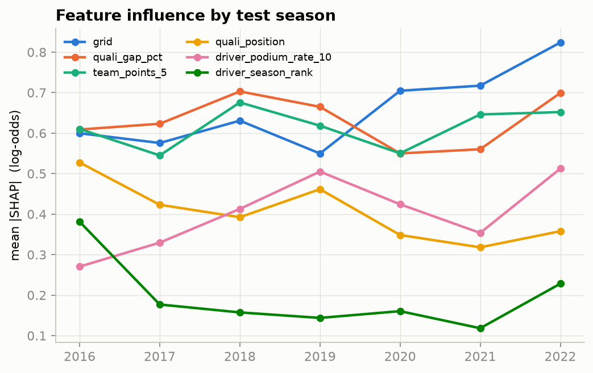
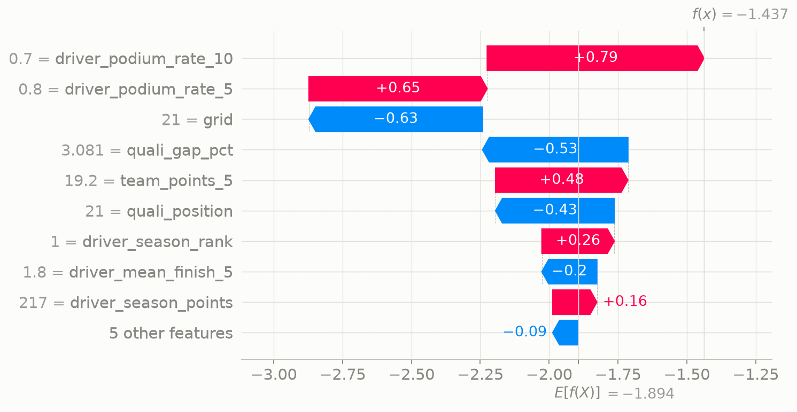
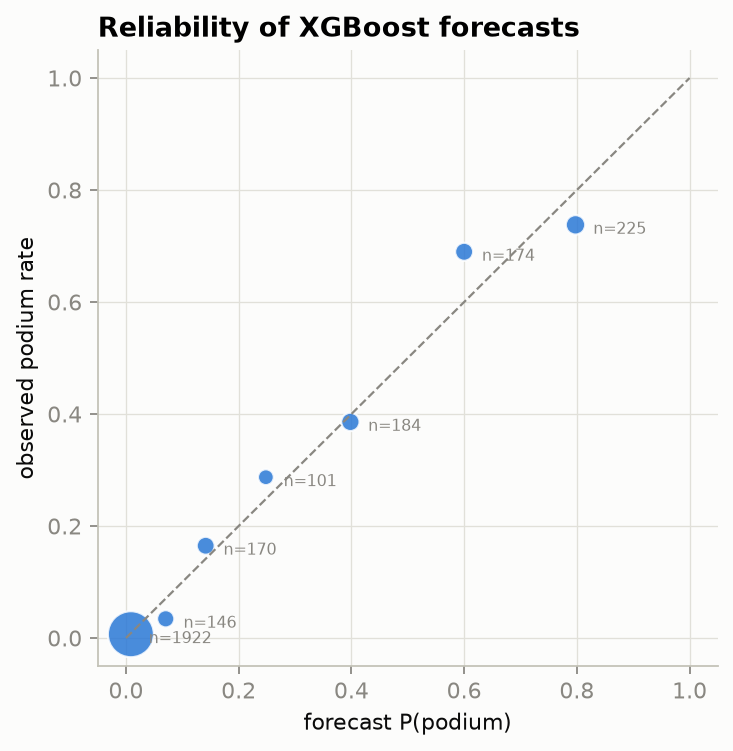

# F1 podium forecast

**Before a Formula 1 race starts, which drivers will finish on the podium, and
can a model say so better than the starting grid alone?**

A pre-race podium probability model built with XGBoost on 15 seasons of
Formula 1 (2010 to 2024), validated with a season-by-season walk-forward
backtest with no look-ahead bias, judged against the starting grid as the
benchmark, and explained with SHAP. Built as a portfolio project for
quantitative finance roles: the method (point-in-time features, a leakage
test, proper scoring rules, an untouched holdout, attribution) is the point,
not the sport.

**In one paragraph.** Over seven out-of-sample test seasons (2016 to 2022) the
model beats the grid in every season (2019 by a margin within run-to-run
noise), cutting log loss from 0.231 to 0.203 and adding 6.2% Brier skill. Its probabilities are calibrated without any
post-processing. On the untouched 2023 to 2024 holdout it wins in 2023 and
loses in 2024, netting a small log-loss gain and no Brier skill. SHAP shows
three things carry the forecast in roughly equal measure: where the car
starts, how far off the pole lap it qualified, and how many points its team
has scored lately. Hyperparameter tuning was tried and made things worse out
of sample, so the model ships with fixed defaults.

| | |
|---|---|
| Rows | 6,436 driver-race pairs, 305 races, 2010 to 2024 |
| Target | finished 1st, 2nd or 3rd (14.2% of rows) |
| Features | 14, all computable before the race |
| Validation | expanding-window walk-forward, test 2016 to 2022; holdout 2023 to 2024 |
| Best model | XGBoost, depth 3, fixed defaults, early-stopped on the last training season |
| Code | 8 modules, under 700 lines, 21 unit tests, CI |

If you have no background in modelling, these are the only terms you need:

| Term | Meaning here |
|---|---|
| **Model** | A procedure that turns facts about a driver before a race into a probability of a podium |
| **Feature** | One of those facts, as a number: grid slot, podium rate over the last 10 races, and so on |
| **Training** | Showing the model past races, with their results, so it can learn how features relate to podiums |
| **Testing** | Scoring the model on seasons it never saw in training; the only numbers that count |
| **Backtest** | Pretending to be at each past season in turn, training only on what was known then, and checking the forecasts. Here it means forecast evaluation only: there are no odds, bets or profit figures anywhere in this project |
| **Benchmark** | The simple forecast the model has to beat: here, the podium rate for each grid slot |
| **Overfitting** | Memorising the training races instead of learning general patterns; looks great in training, fails on new seasons |
| **Calibration** | Whether a "30% chance" really comes true about 30% of the time |
| **SHAP** | A way of splitting one forecast into the contribution of each feature, so a prediction can be explained |

---

## Contents

1. [The question, in plain terms](#1-the-question-in-plain-terms)
2. [Results](#2-results)
3. [What drives the forecasts (SHAP)](#3-what-drives-the-forecasts-shap)
4. [How to read the metrics](#4-how-to-read-the-metrics)
5. [The data](#5-the-data)
6. [The base table](#6-the-base-table)
7. [Features](#7-features)
8. [Leakage, and the test that guards against it](#8-leakage-and-the-test-that-guards-against-it)
9. [Validation: walk-forward by season](#9-validation-walk-forward-by-season)
10. [Models](#10-models)
11. [Calibration](#11-calibration)
12. [Honest reading of the result](#12-honest-reading-of-the-result)
13. [On a CV, and in an interview](#13-on-a-cv-and-in-an-interview)
14. [Reproduce it](#14-reproduce-it)
15. [Repository layout](#15-repository-layout)

---

## 1. The question, in plain terms

Before every Grand Prix, each of the 20 or so drivers has some chance of
finishing in the top three. We want a number for that chance, for every driver
in every race, using only facts known before the lights go out: where they
qualified, how they and their team have been doing lately, how the
championship stands, and how they have done at this track before.

A forecast is only useful if it beats the obvious guess. In F1 the obvious
guess is the starting grid: since 2010, pole position has finished on the
podium 80% of the time, second on the grid 69%, third 51%, and from eighth
back under 5%. So every model here is compared with a benchmark that knows
nothing except the grid slot and its historical podium rate.

The finance analogy runs through the project. The grid is the market price,
already impounding most of the information. Driver form is momentum. Team form
is sector momentum. Championship points are relative strength. DNF rate is
default risk. The backtest is an expanding-window walk-forward, the discipline
used to validate trading signals. The holdout is the out-of-sample period you
look at once.

## 2. Results

### Walk-forward backtest, test seasons 2016 to 2022

For each test season the model is trained on every season before it, then
scored on that season. Mean over the seven test seasons; lower is better for
log loss and Brier, higher for the rest.

| Model | Log loss | Brier | ROC-AUC | PR-AUC | Calibration error | Top-3 hit rate | Brier skill vs grid |
|---|---|---|---|---|---|---|---|
| Grid baseline | 0.231 | 0.068 | 0.922 | 0.670 | 0.025 | 69.9% | 0 |
| Logistic regression | 0.212 | 0.065 | 0.938 | 0.713 | 0.025 | 68.8% | +4.2% |
| **XGBoost, fixed defaults** | **0.203** | **0.064** | **0.944** | **0.729** | 0.031 | 69.9% | **+6.2%** |
| XGBoost, tuned per window | 0.205 | 0.065 | 0.943 | 0.717 | 0.033 | 71.1% | +4.9% |



Season by season, so the stability of the edge is visible rather than one
lucky year. Brier skill against the grid baseline:

| Test season | Logistic | XGBoost | XGBoost tuned |
|---|---|---|---|
| 2016 | +4.6% | +6.0% | +3.3% |
| 2017 | +2.3% | +5.3% | +5.8% |
| 2018 | +4.3% | +9.6% | +9.5% |
| 2019 | -4.6% | +1.2% | -4.3% |
| 2020 | +7.6% | +7.4% | +6.3% |
| 2021 | +5.2% | +9.6% | +9.4% |
| 2022 | +10.2% | +4.4% | +4.4% |

XGBoost with fixed defaults is the only model that beats the grid in all seven
seasons. 2019 was hard for every model: Mercedes started at the front and
finished there, so the grid was almost perfectly informative. The 2019 margin
is thin enough to depend on the computer: the same code and library versions
on an x86 Linux machine give -1.3% for 2019 and +5.7% on average, because
XGBoost's random row sampling plays out slightly differently. The numbers here
come from an Apple-silicon Mac with the versions pinned in `pyproject.toml`.

### Holdout, 2023 to 2024

These two seasons were never used for any decision. Every model was trained
once on 2010 to 2022 and scored once.

| Model | Season | Log loss | Brier | ROC-AUC | Brier skill vs grid |
|---|---|---|---|---|---|
| Grid baseline | 2023 | 0.257 | 0.074 | 0.896 | 0 |
| | 2024 | 0.230 | 0.069 | 0.920 | 0 |
| | both | 0.243 | 0.071 | 0.909 | 0 |
| Logistic regression | 2023 | 0.224 | 0.067 | 0.927 | +10.1% |
| | 2024 | 0.233 | 0.072 | 0.927 | -4.5% |
| | both | 0.228 | 0.069 | 0.928 | +2.8% |
| **XGBoost, fixed defaults** | 2023 | 0.226 | 0.069 | 0.928 | +7.5% |
| | 2024 | 0.237 | 0.073 | 0.926 | -7.2% |
| | both | 0.231 | 0.071 | 0.928 | +0.1% |
| XGBoost, tuned per window | 2023 | 0.222 | 0.068 | 0.929 | +8.4% |
| | 2024 | 0.223 | 0.069 | 0.933 | -1.2% |
| | both | 0.223 | 0.069 | 0.932 | +3.6% |

In 2023 every model beat the grid comfortably. In 2024 none did on Brier
score. Pooled over both years, XGBoost improves log loss (0.243 to 0.231) and
ranking quality (ROC-AUC 0.909 to 0.928) but its Brier skill is flat. Section
12 says what to make of this.

## 3. What drives the forecasts (SHAP)

SHAP values decompose each forecast into a contribution per feature, in
log-odds. They are computed on each walk-forward test season from the model
fitted on the seasons before it, so the explanations are as out-of-sample as
the forecasts.



**Three features carry the model, in roughly equal measure.** Grid slot
(0.66), the gap to the pole lap in percent (0.63) and the team's recent points
(0.62) each move a typical forecast by about two-thirds of a log-odds unit,
which is roughly a doubling of the odds. Then come qualifying position (0.41)
and the driver's podium rate over the last ten races (0.40). Everything else
is small.

Two readings matter:

- **The qualifying gap in time adds information beyond the grid order.** Pole
  by half a second and pole by a hundredth are the same grid slot but very
  different forecasts. The grid baseline cannot see this; the model can.
- **The car matters as much as the start.** Team points over the last five
  races carry as much weight as grid position. A strong car that qualified
  badly (a penalty, a wet session, a mistake) still has a real podium chance,
  and this is where most of the model's edge over the grid comes from.



Influence shifts across seasons the way factor exposures shift across market
regimes. Grid position became more important from 2020 on while the
qualifying gap became less so, consistent with closer qualifying margins.
Championship rank mattered most in 2016 and little afterwards.



**One forecast taken apart.** Lewis Hamilton, 2016 Belgian Grand Prix,
starting 21st after engine penalties. The base rate for any driver is a 13%
podium chance (log-odds -1.89). His form (podium rate over the last ten races,
+0.79; last five, +0.65), his car (team points, +0.48) and his championship
position (+0.26) pull the forecast up; the grid slot (-0.63), the qualifying
gap (-0.53) and qualifying position (-0.43) pull it down. Net forecast: 19%.
The grid baseline would have said about 1%. He finished third. The model did
not predict the podium, but it priced it as a live possibility because the
penalty was a grid penalty, not a pace penalty.

## 4. How to read the metrics

Accuracy is useless here: predicting "no podium" for everyone is already 86%
accurate because only 3 of about 20 cars make it. These are the metrics used
for probability forecasts.

| Metric | What it answers | Finance analogue |
|---|---|---|
| **Log loss** | Are the probabilities sharp and honest? Punishes confident wrong forecasts heavily. The primary metric. | Proper scoring of a forecast |
| **Brier score** | Mean squared error between the forecast probability and the 0/1 outcome. | Forecast error |
| **Brier skill** | 1 minus (model Brier / grid Brier). Positive means the model adds information beyond the grid. | Excess return over a benchmark |
| **ROC-AUC** | Pick one podium finisher and one non-finisher at random: how often does the model rank them correctly? | Information coefficient |
| **PR-AUC** | Ranking quality focused on the rare positive class; more sensitive than ROC-AUC when positives are 14% of rows. | Precision of a long book |
| **Calibration error (ECE)** | Does "30%" happen 30% of the time? Mean gap between predicted and observed rate across ten bins. | Model risk, forecast reliability |
| **Top-3 hit rate** | Of the three drivers the model rates highest in each race, what share made the podium? | Hit rate of a top-decile portfolio |

The top-3 hit rate barely moves between models: all of them pick the front
row. The difference between models is in how they price the midfield, which
log loss and Brier capture and hit rate does not.

## 5. The data

Source: the Kaggle dataset
[rohanrao/formula-1-world-championship-1950-2020](https://www.kaggle.com/datasets/rohanrao/formula-1-world-championship-1950-2020),
14 relational CSV files covering every championship race since 1950 (despite
the name it runs to the end of 2024). The CSVs are not committed; section 14
shows how to download them. Missing values are written as the literal `\N`.

| Table | One row per | Used for |
|---|---|---|
| `results` | driver and race | the target (finishing order) and all past-form features |
| `races` | race | date, season, round and circuit: the time index for every split |
| `qualifying` | driver and race | qualifying position and Q1/Q2/Q3 lap times (known before the race) |
| `drivers` | driver | names, for the SHAP example only |

Not used: `driver_standings` and `constructor_standings` (recorded after each
race, so a trap; championship points are recomputed from results instead),
`lap_times` and `pit_stops` (left for a future pace feature), and
`sprint_results` (excluded by design).

**Why 2010 onwards.** Earlier eras had different points systems, grid sizes,
reliability and data coverage. 2010 is the start of the current 25-point
scoring system; it gives 305 races and 6,436 driver-race rows within one
regime.

**Sprints are excluded.** Sprint races (2021 on) award championship points but
are not loaded. Season-points features use Grand Prix points only, so ranks
for 2021 to 2024 differ slightly from the official standings. This keeps one
definition of "a race" throughout.

## 6. The base table

Everything starts from one table with one row per driver per race
(`dataset.py`). Its columns fall into three groups, and the split is the first
line of defence against leakage:

- **Keys**: race, driver, constructor, season, round, date, circuit.
- **Pre-race facts**, legal as features for this race: grid slot, a pit-lane
  start flag, qualifying position, best qualifying lap in seconds.
- **Outcomes**, never used as features for the same race: finishing order,
  whether the car was classified, points scored, status, and the label
  `podium` = finishing order is 1, 2 or 3.

Two cleaning decisions:

- **Pit-lane starts.** The dataset codes a pit-lane start as grid 0. Treating
  that as "better than pole" would be wrong, so those cars are moved to one
  slot behind the last car on the grid, and a flag records that it happened.
- **Best qualifying lap.** Q1, Q2 and Q3 times are parsed from `m:ss.fff`
  strings and the fastest of the three is kept. It feeds the gap-to-pole
  feature.

## 7. Features

Fourteen features in five families, built in `features.py` from the base
table alone. The rule for every one: for race *t*, use only races before *t*
plus pre-race facts for *t*. Every rolling window is shifted back one race
before it is computed, the way a momentum factor is built.

| Family | Feature | Plain meaning | Finance analogue |
|---|---|---|---|
| Starting position | `grid` | Where the car starts | Today's price |
| | `pit_lane_start` | Starting from the pit lane (1/0) | Flagged event |
| | `quali_position` | Qualifying classification | |
| | `quali_gap_pct` | How far off the fastest qualifying lap, in percent (0 for pole) | Spread to best |
| Driver form | `driver_podium_rate_5`, `_10` | Share of the driver's last 5 / 10 races that ended on the podium | Momentum |
| | `driver_mean_finish_5` | Average finishing order over the last 5 races | Trend |
| | `driver_dnf_rate_10` | Share of the last 10 races not classified | Default risk |
| Team form | `team_podium_rate_5` | Podium rate of the team's two cars over its last 5 races | Sector momentum |
| | `team_points_5` | Mean points per car per race over the team's last 5 races | |
| Championship state | `driver_season_points` | Points scored earlier this season | Relative strength |
| | `driver_season_rank` | Rank of that total among drivers in this race | |
| | `team_season_points` | Team's points earlier this season | |
| Track history | `driver_circuit_mean_finish` | Driver's average finish in previous visits to this circuit since 2010 (missing on a first visit) | Seasonality |

Why these and not more: the plan allowed 25 to 40 features, but a few strong,
explainable ones were preferred. Every feature has a one-sentence meaning a
non-specialist can follow. Missing values (a driver's first race, a first
visit to a circuit) are left missing; XGBoost handles them natively and the
logistic model imputes the median within its training window.
History starts in 2010, so form windows are empty at the first 2010 race and
fill up over the next few, and no 2010 row has circuit history. This thins
out the earliest training rows only; every test season has full history.

## 8. Leakage, and the test that guards against it

Look-ahead bias is how sports and finance models go wrong: a feature quietly
uses information from the future and the backtest looks wonderful. This
dataset invites it in several ways, and each is handled explicitly.

| Trap | How it is avoided |
|---|---|
| Standings tables are post-race: the standings row for race *t* already includes race *t*'s points | Standings tables are not used; season points are cumulated from results and the current race's points subtracted |
| Outcome columns (`position`, `points`, `statusId`, `laps`, `fastestLap`...) describe the race being predicted | Kept in a separate `OUTCOMES` group, never in the feature list |
| A rolling mean that includes the current race leaks the label | Every window is `shift(1)` then roll |
| Season aggregates ("average finish in 2019") use the whole season | Only expanding-to-date versions exist |
| Random K-fold mixes future races into training | Splits are strictly by season and date |
| Preprocessing fitted on all data | Imputer, scaler and model are fitted inside each training window only |

**The leakage test.** Rules are good; a test is better. `tests/test_features.py`
builds features on a synthetic three-season table, then scrambles the results
of one mid-sample race (reverses the finishing order, zeroes the points, marks
every car as not finishing) and rebuilds. It asserts that every feature for
that race and every earlier race is bit-for-bit unchanged, and that at least
one later race *does* change, so the test cannot pass trivially. Any new
feature that peeks at the current race fails it. It runs in CI with no real
data.

## 9. Validation: walk-forward by season

```
train 2010-2015  ->  test 2016
train 2010-2016  ->  test 2017
train 2010-2017  ->  test 2018
   ...
train 2010-2021  ->  test 2022
train 2010-2022  ->  HOLDOUT 2023-2024, scored once
```

- **Outer loop.** Seven folds, test seasons 2016 to 2022. Each fold trains on
  every season before the test season and reports its own metrics, so skill
  is visible season by season rather than as one blended number.
- **Inner validation.** Inside each training window the *last* training
  season is held out again. It chooses the number of boosting rounds (early
  stopping) and, when tuning is on, the hyperparameters. The outer test
  season never influences any choice. The model is then refitted on the whole
  window.
- **No purge gap.** In finance, labels that take time to resolve need a gap
  between train and test. Here every label resolves on race day and every
  feature is lagged, so no gap is needed. Saying so explicitly is part of the
  method.
- **Holdout.** 2023 and 2024 were not touched during development. They were
  scored once, after every modelling decision was frozen, and the result is
  reported as it came out.
- **Why not K-fold.** Shuffled cross-validation would train on 2020 races to
  predict 2016 ones. Features like "podium rate over the last 10 races" would
  be learned from the future. The scores would be higher and meaningless.

## 10. Models

Three model families, in order of complexity. All share one small interface
(`fit(df)`, `predict_proba(df)`) so the backtest treats them identically.

**Benchmark 1: grid baseline** (`baseline.py`). For each grid slot, the
historical podium rate in the training window, with light additive smoothing
toward the overall rate so a slot with few starts is not noisy. Slots beyond
20th share one pooled rate. This is the "market price".

**Benchmark 2: logistic regression** (`train.py`). Median imputation, standard
scaling, then an L2-regularised logistic regression on the 14 features. A
linear model on the same inputs shows how much of XGBoost's gain comes from
the features and how much from non-linearity. Answer: most of it is the
features (+4.2% of the +6.2%).

**XGBoost** (`train.py`). If you have never met a machine-learning model,
here is the idea. Imagine a very simple rule for picking podium finishers:
"if the car starts in the top three, say podium; otherwise say no". That rule
is a *decision tree* with one question. A bigger tree asks a few questions in
sequence ("top three on the grid? if not, has the team scored more than 10
points a race lately? if so, is the driver's recent podium rate above 30%?")
and ends each path with a number: how likely a podium is for drivers who
answered that way.

One tree on its own is crude. *Boosting* fixes that by building trees in
turn. The first tree makes its guesses. The second tree is built only to
correct where the first one was most wrong. The third corrects what is still
wrong after the first two, and so on for a few hundred rounds, each tree
allowed only a small say. Add all their numbers up and you get the forecast.
Because every forecast is just a sum of small, readable steps, it can be
taken apart afterwards to see which facts pushed it up or down; that is what
the SHAP charts in section 3 do. XGBoost is simply a fast, widely used
program that does this boosting, and it copes with missing information (a
driver's first race) without needing it filled in.

The settings below are deliberately cautious for a dataset of a few thousand
rows, where a model that is allowed too much freedom will memorise the past
instead of learning from it:

| Setting | Value | Why |
|---|---|---|
| Max tree depth | 3 | Shallow trees: a few interactions, little overfitting |
| Learning rate | 0.05 | Slow learning, many small steps |
| Min child weight | 5 | No leaf fits a handful of rows |
| Row / column subsampling | 0.8 / 0.8 | Each tree sees a different sample |
| L2 regularisation | 1 | Default |
| Number of rounds | early stopping on the last training season, patience 50 | Typically 90 to 210 rounds |

**Tuning was tried and rejected.** A 20-draw random search over depth,
learning rate, child weight, subsampling and regularisation, scored by log
loss on the inner validation season of each window, improved that inner loss
by under 0.005 per fold. The chosen settings jumped around from season to
season (depth 2 one year, depth 4 the next). Out of sample the tuned model was
slightly *worse* than the defaults (+4.9% versus +6.2% Brier skill). One
season of about 400 rows is too small to tune on without fitting its noise.
The search code remains so the result is reproducible; the model ships with
its defaults.

## 11. Calibration



Pooled over the 2016 to 2022 test seasons, dot area proportional to the number
of forecasts in the bin. A perfectly calibrated model sits on the diagonal.

| Forecast bin | Drivers | Predicted | Observed |
|---|---|---|---|
| 0 to 5% | 1,922 | 0.9% | 0.7% |
| 5 to 10% | 146 | 7.1% | 3.4% |
| 10 to 20% | 170 | 14.1% | 16.5% |
| 20 to 30% | 101 | 24.8% | 28.7% |
| 30 to 50% | 184 | 39.8% | 38.6% |
| 50 to 70% | 174 | 60.0% | 69.0% |
| 70 to 100% | 225 | 79.8% | 73.8% |

Overall the model predicts a 14.8% podium rate and 14.8% is observed.

**Do the forecasts within a race add up?** Every race has exactly three
podium places, so the probabilities for one race should sum to 3. The model
is never told this and is scored one driver at a time, yet on average they
do: the mean sum is 3.01, 90% of races fall between 2.5 and 3.5, and the
extremes are 2.3 and 3.8. Rescaling each race to sum to exactly 3 (the
analogue of normalising portfolio weights) moves log loss from 0.2024 to
0.2013 and Brier from 0.0638 to 0.0633, too little to matter, so the raw
per-driver probabilities are what is reported.

Two calibrators were nonetheless tried, each fitted on the inner validation
season of its window so they never saw the test season:

| Variant | Log loss | Brier | Calibration error |
|---|---|---|---|
| XGBoost as is | 0.203 | 0.064 | 0.031 |
| + Platt scaling | 0.204 | 0.064 | 0.030 |
| + isotonic regression | 0.233 | 0.067 | 0.033 |

Platt scaling changed nothing meaningful; isotonic regression, with one
season to learn from, overfitted and hurt. No calibrator is used. The small
calibration-error gap to the grid (0.031 vs 0.025) is within what ten bins of
400 rows show by chance.

## 12. Honest reading of the result

### Is the edge real?

The first question a quantitative reader asks. The table puts error bars on
it: the model's log-loss gain over the grid, averaged per race, with a 95%
confidence interval from resampling races (races, not drivers, because the
drivers in one race are not independent: exactly three of them podium).

| Period | Gain per race | 95% CI | Races where the model was better |
|---|---|---|---|
| Walk-forward 2016 to 2022 | +0.028 | +0.019 to +0.038 | 72% of 144 |
| Holdout 2023 | +0.031 | +0.002 to +0.060 | 64% of 22 |
| Holdout 2024 | -0.007 | -0.022 to +0.011 | 25% of 24 |
| Holdout pooled | +0.011 | -0.006 to +0.029 | 43% of 46 |

Two layers of out-of-sample are in play. The seven walk-forward seasons are
already out of sample: each was scored by a model that never saw it. There
the edge is robust: the interval is well clear of zero, the model wins in
nearly three races out of four, and all seven seasons are positive. The
holdout is a stricter second layer, two seasons that also never influenced
any design decision. There the edge held in 2023, with an interval that just
clears zero, and vanished in 2024, where the grid was better in three races
out of four. Pooled over both holdout years the gain is positive but not
distinguishable from zero with only 46 races.

Nine out-of-sample seasons, one lost. That is what a real but small edge
looks like: a single season where the grid is unusually informative (2024's
grid log loss was among the lowest of any year, as in 2019, the other year
the model barely won) is enough to erase it.

The race-level numbers also show *how* the model wins. In the holdout it was
better in fewer than half the races yet had a positive mean gain. Its wins
are large and rare: the races where a strong car started far back and the
model priced a podium the grid gave almost no chance. Its losses are small
and frequent: the premium it pays every race for keeping that possibility
open. That is a long-volatility payoff profile, and it is a more accurate
description of what the model does than "beats the grid".

### The rest

- **The signal is real but modest.** The grid is set by a qualifying session
  held the day before on the same track in the same car, which is about the
  best possible predictor of race pace. A consistent gain of 0.03 in log loss
  against it is an edge, not a large one.
- **The holdout is mixed, and is reported as such.** 2023 agreed with the
  backtest (+7.5% Brier skill). 2024 did not (-7.2%), and no model beat the
  grid that year. Pooled, the model still ranks drivers better (ROC-AUC 0.928
  vs 0.909) with lower log loss, but Brier skill is flat. The right reaction
  is to report it, not to tune until it looks better, which would turn the
  holdout into another training set.
- **The tuned model did better on the holdout than the defaults.** It was
  also worse on the seven development seasons. Preferring whichever variant
  won on the holdout is exactly the selection bias the holdout exists to
  prevent, so the defaults remain the model.
- **What would move the needle.** Pace features from `lap_times` and
  `pit_stops` (how fast the car actually was last race, not just where it
  finished), weather, and regulation-era indicators are the obvious next
  features. Each would go through the same leakage test.
- **No betting claims.** The dataset has no odds, so nothing here says the
  model would make money. The claims are about forecast skill against the
  grid.

## 13. On a CV, and in an interview

Suggested bullet:

> **F1 podium probability model (Python, XGBoost, SHAP).** Built a
> point-in-time feature pipeline and a season-by-season walk-forward backtest
> with no look-ahead bias on 15 seasons of race data; XGBoost beat a
> starting-grid benchmark by 6.2% Brier skill (log loss 0.231 to 0.203) over
> seven walk-forward test seasons, with calibrated probabilities and SHAP
> attribution of what drives each forecast; reported an untouched 2023-24
> holdout as it came out.

Questions this project is ready for:

- *Why not cross-validation?* Because the features are lagged aggregates. A
  shuffled fold trains on the future. Walk-forward by season is the only
  honest split, and the leakage test proves the features obey it.
- *What is the benchmark and why?* The grid, because it is the market price:
  it already impounds qualifying pace. A model only matters if it adds
  information beyond it, and Brier skill measures exactly that.
- *Why did you reject tuning?* It won on the inner validation season by a
  hair and lost out of sample. With 400 rows per season the search fits
  noise. Fixed, conservative defaults were the more defensible choice.
- *The holdout was flat on Brier skill. Why not fix it?* Because the holdout
  is spent. Changing the model after seeing it would make it a validation
  set and the reported number would no longer mean anything.
- *Did the edge persist out of sample?* In eight of nine out-of-sample
  seasons. The bootstrap interval is clear of zero over the seven
  walk-forward seasons and over 2023, and includes zero over 2024 and over
  the pooled holdout. A small edge that one quiet season can erase, reported
  with its error bars.
- *What does the model know that the grid does not?* How far off the pole
  lap a car qualified, and how strong the team has been lately. SHAP shows
  those two carry as much weight as the grid slot itself.
- *Is a 19% forecast useful if the driver then finishes third?* Yes, if 19%
  forecasts come true about 19% of the time, which the reliability diagram
  shows they do. Calibration is what makes a probability usable for sizing.

## 14. Reproduce it

Requirements: Python 3.12 or newer. Library versions are pinned so the numbers reproduce.

```bash
python -m venv .venv && source .venv/bin/activate
pip install -e ".[dev]"
pytest                          # 21 unit tests, no data needed, a few seconds
```

Download the data (public dataset; no Kaggle account needed):

```bash
pip install kagglehub
python -c "
import kagglehub, shutil, pathlib
src = pathlib.Path(kagglehub.dataset_download('rohanrao/formula-1-world-championship-1950-2020'))
dst = pathlib.Path('data/raw'); dst.mkdir(parents=True, exist_ok=True)
for f in src.rglob('*.csv'): shutil.copy(f, dst / f.name)
"
```

Then:

```bash
python -m f1model.evaluate --data-dir data/raw --holdout  # backtest, reliability, holdout, bootstrap; two figures; ~40 s
python -m f1model.explain --data-dir data/raw             # SHAP values and three figures; ~15 s
```

Every number and figure in this README comes from those commands. Tables land
in `reports/` as CSV and figures in `reports/figures/`.

## 15. Repository layout

```
src/f1model/
  load.py        read the Kaggle CSVs, type the date column, treat \N as missing
  dataset.py     one row per driver per race; keys vs pre-race facts vs outcomes
  features.py    the 14 point-in-time features
  baseline.py    grid baseline: smoothed podium rate per grid slot
  splits.py      expanding-window walk-forward by season; holdout seasons
  train.py       logistic benchmark; XGBoost with inner-season early stopping and optional search
  evaluate.py    metrics, reliability table, backtest and holdout; the results script
  explain.py     out-of-sample SHAP values and every figure in this README
tests/
  conftest.py    two tiny hand-built races in the raw schema, plus a synthetic three-season table
  test_*.py      21 tests: cleaning, feature values, the leakage test, splits, metrics, bootstrap, model, SHAP
reports/figures/              the five figures above, regenerated by the scripts
.github/workflows/tests.yml   runs pytest on every push
```

Under 700 lines of package code. No config system, no notebooks, no helper
used once: the aim is code a reader can follow top to bottom.

## Licence

MIT.
